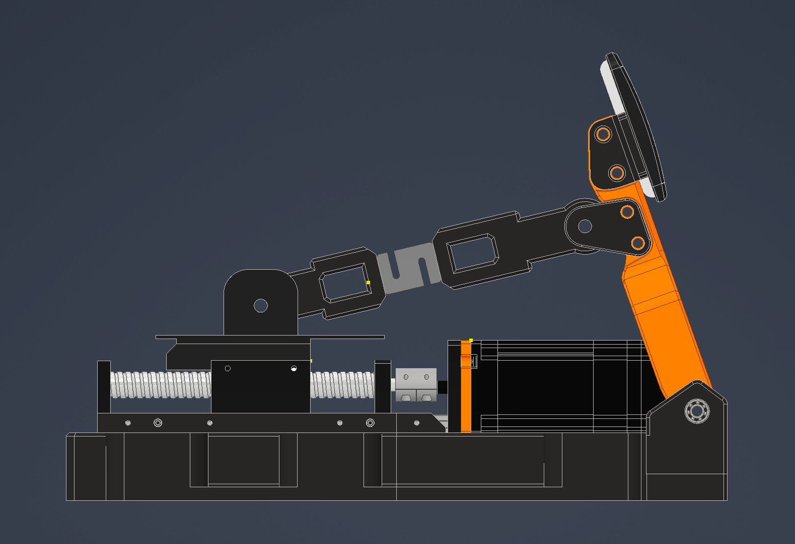
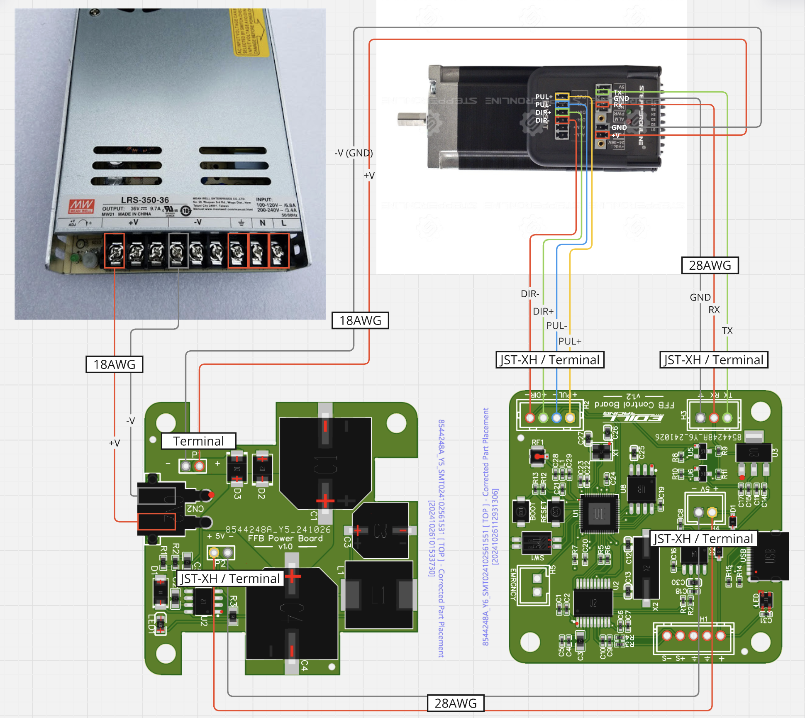

# DIY Active FFB Pedal

My build of a force-feedback (active) sim racing pedal. It runs the [DIY-Sim-Racing-FFB-Pedal](https://github.com/ChrGri/DIY-Sim-Racing-FFB-Pedal) firmware.

## Hardware
- StepperOnline integrated servo driving a ballscrew sled
- Load cell in the push rod between the sled and the pedal arm
- MEAN WELL LRS-350-36 power supply (36 V)
- FFB power board + FFB control board (see the wiring below)

## Repo layout

| Folder | Contents |
|---|---|
| `stl/` | Printed parts: base, pedal lever, push rods, hinge levers (v2 and v3), clamp holder, PCBA model |
| `stl/from_3mf/` | The other parts from the print project, exported as STLs: faceplate links, pushrod links, pedal face, faceplate support, axis stop, clamps, motor spacer, dust cover |
| `project/` | `Full_Build_Active_Pedal.3mf`, the QIDI Studio print project with the print settings |
| `docs/` | [Kinematics](docs/kinematics.md): SimHub values and how they were measured |
| `tools/` | `kinematics.py`: pedal angle and force ratio across sled travel |
| `images/` | CAD renders, wiring diagram, SimHub screenshot |

## Kinematics (SimHub)

| a | b | d | c horizontal | c vertical | travel |
|---|---|---|---|---|---|
| 202 | 130 | 34 | 224 | 64 | 130 |

Set **end position %** to about 60–70% to keep the pedal where the rod still pushes squarely on the arm. See [docs/kinematics.md](docs/kinematics.md) for the details.

## Wiring

