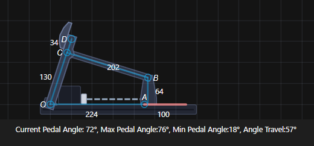

# Kinematics

These are the values for the **Kinematics** tab of the DIY-Sim-Racing-FFB-Pedal SimHub plugin.

## What each point is

| Point | What it is |
|---|---|
| O | Pedal hinge on the base (reference point) |
| C | Joint where the load-cell rod meets the pedal arm |
| D | Where the foot pushes (centre of the pedal face) |
| B | Joint where the rod meets the sled |
| A | Point on the rail directly under B, with the sled at home |

Pressing the pedal pushes the sled away from the motor. **Home** is the sled at the motor-side stop.

## Values

| Setting | Value | How it was found |
|---|---|---|
| a (rod C→B) | **202** | 201.5 mm measured. Push rods: 92 (`push_rod_a_v2`) + 75 (`push_rod_b_v2`) + about 35 for the load cell |
| b (O→C) | **130** | `lever_v2` hinge bearing to the `PUSHROD_LINK` pivot: 130.4 from the STL, 130.4 in the render |
| d (C→D) | **34** | The foot sits 164 mm from the hinge. Range 21–47 depending on where the face sits in its slot |
| c horizontal (O→A) | **224** | Sled at the motor-side stop. It is 263 in the side render, where the sled is about 40 mm out |
| c vertical (A→B) | **64** | 63.7 mm measured |
| travel | **130** | Must be higher than the real stroke (see below) |

All values except b were measured off the CAD side-view render (`images/cad_side.png`), scaled at 0.304 mm/px using the arm's known hole spacings. Expect about ±1–2 mm.

## Pedal angle and force ratio

Force ratio is foot force divided by load-cell force.

| Sled from home | Pedal angle | Force ratio |
|---|---|---|
| 0 mm | 76° | 0.79 |
| 20 mm | 67° | 0.79 |
| 40 mm | 59° | 0.75 |
| 60 mm | 49° | 0.68 |
| 80 mm | 38° | 0.53 |
| 100 mm | 19° | 0.17 |

Past about 80 mm the rod lines up with the pedal arm, and the force reaching your foot collapses. Limit the swing with **end position %** (about 60–70%), not with travel.

You can rerun this table with your own values: `python tools/kinematics.py`.

## How travel works in the firmware

The firmware finds its range only at power-up:

1. It drives toward the motor until it hits the stop, and that becomes zero.
2. It drives the other way until it hits the far stop, or until it has moved the **travel** distance, whichever comes first.

So travel is only a cap on that search. It isn't used in the pedal geometry. Set it above the real stroke, then power-cycle the pedal.

If the range still comes up short, check these:
- **Spindle pitch:** 5 for a 1605 ballscrew, 10 for a 1610.
- **Serial log:** look for the `Max endstop reached` line to see where it stopped.
- **False stop:** binding, or the arm brushing the motor, can trip the current threshold early (default 30%).

## Starting force settings

| | Min force | Max force |
|---|---|---|
| Brake | 3 kg (2–5) | 50 kg (40–60; 30–40 on a rig that flexes) |
| Throttle | 1 kg | 5 kg (4–8) |

Keep brake max force below the "expected max force at max travel" figure in the kinematics tab, and well below the load cell's rating.
